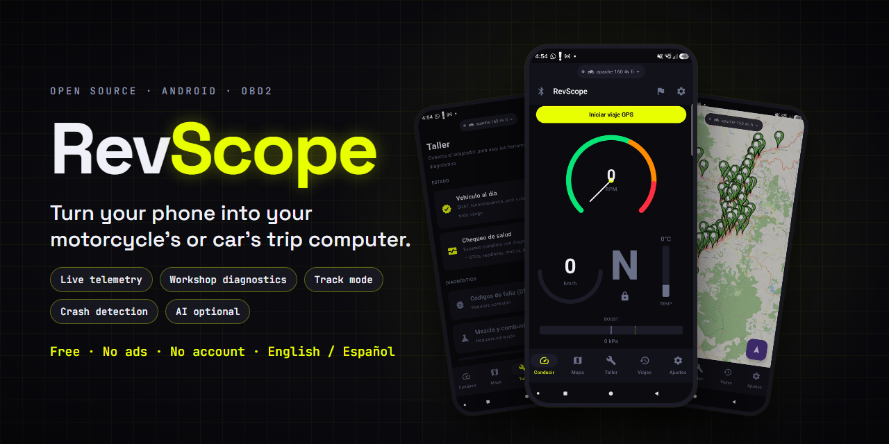
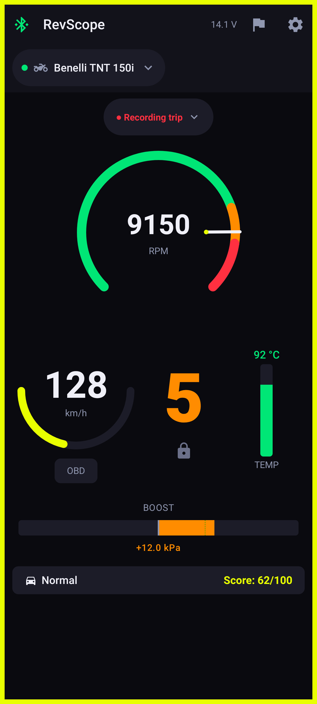
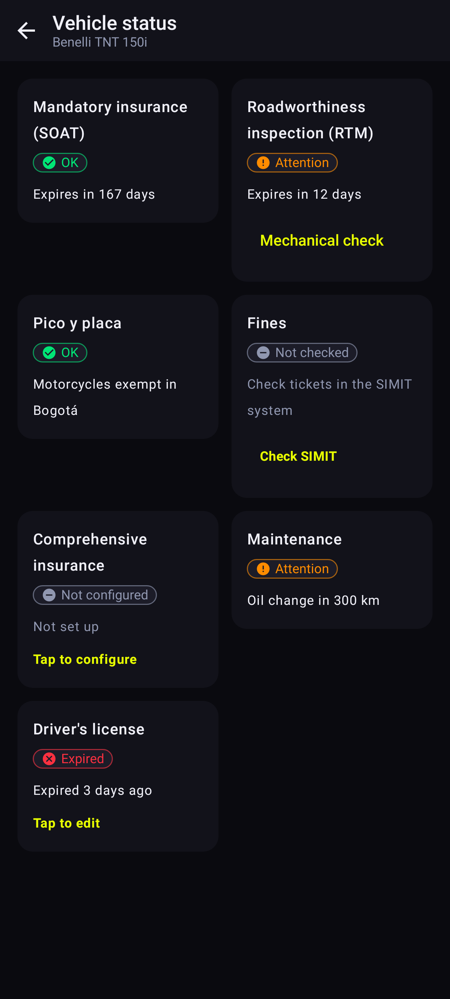
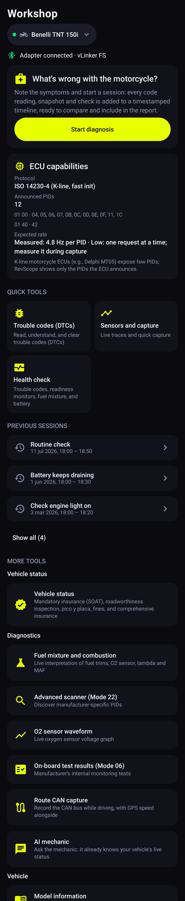
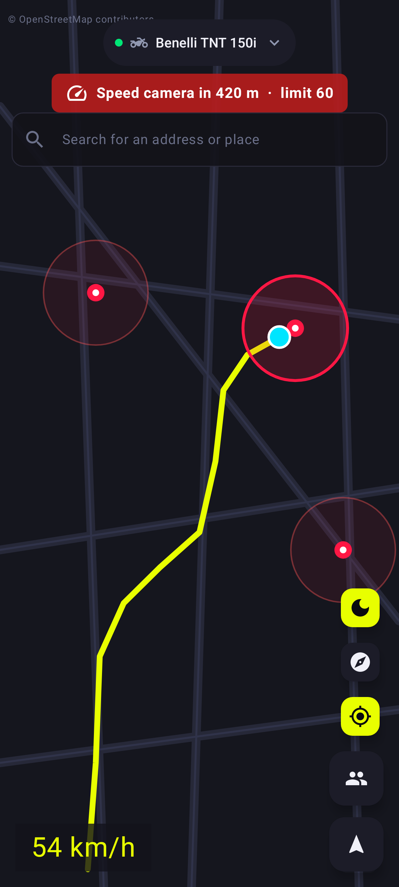
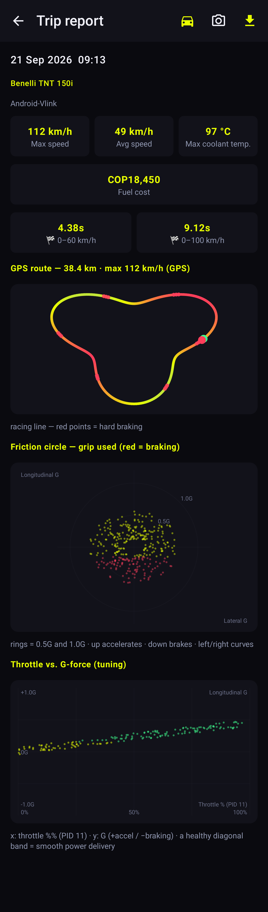
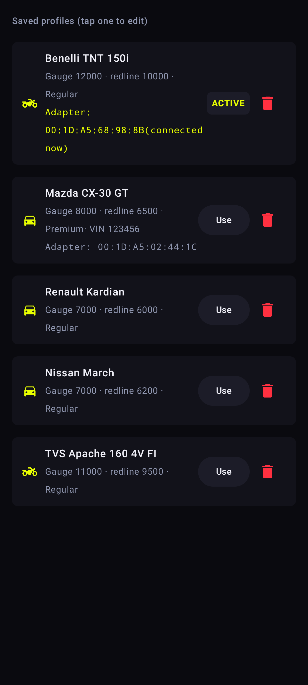

**English** · [Español](README.es.md)

[📥 Download APK](https://github.com/santiquiroz/revscope/releases/latest) · [📲 Installation](docs/en/installation.md) · [📖 User manual](docs/en/user-manual.md) · [❓ FAQ](docs/en/faq.md)

---

RevScope turns a cheap ELM327 Bluetooth adapter and an Android phone into a racing-style dashboard, a workshop diagnostic tool and a ride logger, for motorcycles and cars.

**Free and open source. No ads, no account, no subscription.**

## See it in action

| | | |
|:---:|:---:|:---:|
|  |  |  |
| **Drive** — RPM, speed (OBD or GPS), gear, temperature and shift light | **Vehicle status** — SOAT, inspection (RTM), pico y placa TODAY (Colombia), fines and maintenance | **Workshop** — health check, AI DTCs, fuel mixture, O2 waveform and more |
|  |  |  |
| **Map** — live route on OpenStreetMap with speed cameras marked | **Trip report** — charts with real scales, eco-score, fuel cost and CSV export | **Garage** — multiple vehicles, each with its own adapter and history |

## Why RevScope

- **Built for motorcycles too** — lean angle, G-forces, friction circle, and CAN bus profiles reading gear position, side stand, clutch, and kill switch directly from the bus (tested on a TVS Apache RTR 160 4V).
- **Workshop diagnostics explained in plain language** — one-tap health check, trouble codes explained with AI, live fuel mixture, O2 sensor waveform, Mode 06 test results, Mode 22 manufacturer PID scanner, and odometer tampering verification.
- **Your data stays on your phone** — no account required, no proprietary cloud, and full CSV export with manual or automated backups. Map tiles, speed cameras, rain alerts, and routing query public online services only ([what connects and what you can disable](docs/en/faq.md#does-my-data-leave-my-phone)).
- **Optional AI with your own key** — Claude, OpenAI, Gemini, or any OpenAI-compatible server (including local models via LM Studio), plus a local-network MCP server.

## 🚀 Get started in 3 steps

1. **[Download the APK](https://github.com/santiquiroz/revscope/releases/latest)** and install it — [step-by-step guide](docs/en/installation.md)
2. **Pair your adapter** — Bluetooth ELM327 (e.g. Vgate iCar Pro — [which one to buy](docs/en/faq.md#what-adapter-should-i-buy)) and connect from the app
3. **Set up your vehicle** when prompted — and hit the road 🏁

> 💡 **No adapter?** RevScope still works: the **"GPS trip"** button logs routes, speed, lean angle, and G-forces using only your phone, with speed camera alerts, pico y placa warnings (Colombia), and crash detection included.

## ✨ Features

The app UI, voice alerts, and AI answers are available in English or Spanish, and speed, distance, and temperature units follow your region (km/h or mph, °C or °F).

### 📋 Everyday
- **Automatic pico y placa (Colombia)** — Medellín and Bogotá built in (motorcycles exempt in Bogotá); spoken voice alerts warn you if you enter another restricted city. Optional: your configured AI provider researches driving restrictions for **any city in the world** (pico y placa, hoy no circula, rodízio…) and caches them until expiration · [configure](docs/en/configuration.md#pico-y-placa)
- **Documents up to date (Colombia)** — expiration tracking for SOAT, inspection (RTM), comprehensive insurance, and driver's license with stepped reminders and a daily notification at 5:30 AM
- **Directional speed camera voice alerts (ANSV cameras, Colombia)** — official ANSV registry and OpenStreetMap; alerts only if you are heading toward the camera (directional, not radial), redownloads automatically when traveling to another region, updates weekly, and works offline
- **Fuel cost per trip** — calculated with your local fuel price (regular, premium or diesel) in your currency
- **Mileage-based maintenance** — engine oil, tires, and drive chain/belt tracked against the vehicle's actual odometer

### 🔧 Workshop
- **One-tap health check** — DTCs, inspection readiness (RTM, Colombia), fuel trims, and battery status, interpreted in plain language with status traffic lights and **shareable as an image**
- **AI-explained trouble codes**, **live fuel trim and combustion**, **O2 sensor waveform**, **Mode 06 results**, and **Mode 22 scanner** for manufacturer PIDs
- **Odometer verification** — reads the ECU odometer and flags potential tampering
- **AI mechanic** — chat with an AI mechanic grounded in your vehicle's actual live and historical data · [user manual](docs/en/user-manual.md#workshop)
- **CAN profiles** — true gear position, side stand, clutch, and kill switch read directly from the bus, with live testing before enabling each signal (includes built-in profile for the TVS Apache RTR 160 4V) · [user manual](docs/en/user-manual.md#can-bus-data)

### 🏁 Performance
- **Automatic 0-60 mph / 0-100 km/h with voice announcements**, Track mode with lap timing, lean angle, G-forces, friction circle, and braking zones
- **A/B trip comparison** and **speedometer comparison** (OBD vs GPS to measure real dashboard error)
- **Galaxy Watch** — heart rate streaming integrated into your telemetry · [install on watch](docs/en/installation.md#galaxy-watch-optional)

### 🆘 Safety
- **Crash detection** — hard impact followed by immobility triggers a 60-second alarm, followed by an SMS with your location to your emergency contact (disabled by default, includes test button without sending SMS) · [configure](docs/en/configuration.md#crash-detection)
- **Automatic trip end** — shut off the engine and RevScope saves the trip and stops battery usage automatically

### 🤖 Artificial intelligence (optional, with your own key)
- **4 provider options** — Claude, OpenAI, Gemini, or **any compatible server** (local LM Studio, DeepSeek, Groq, etc.)
- **Local road intelligence** — contextual road alerts and town information with live web search
- **Local network MCP server** — desktop AI clients (Claude Desktop, etc.) query your vehicle over Wi-Fi and, with your permission, perform workshop tasks: VIN and calibrations, Mode 06, module discovery, manufacturer DIDs, per-module DTC clearing, ECU reset, and UDS sequences, with every write confirmed on your phone · [guide](docs/en/configuration.md#local-network-mcp-server)

### 💾 Your data
- **Full CSV export** — every chart, sensor metric, and trip log
- **Backup and restore** — manual exports and automated weekly backups to switch phones without losing data
- **No accounts, no proprietary cloud, no third-party telemetry** — your trips and vehicle logs remain on your phone. Map tiles, speed cameras, rain alerts, and routing query public online services only · [what connects and what you can disable](docs/en/faq.md#does-my-data-leave-my-phone)

## Hardware

- **Adapters**: any ELM327-compatible Bluetooth Classic or BLE adapter (tested reference: Vgate iCar Pro 2S).
- **Vehicles**: cars equipped with OBD-II/EOBD; motorcycles equipped with an OBD diagnostic port.
- **Standalone**: no adapter needed for GPS trips (routes, speed, lean angle, G-forces, speed camera alerts, and crash detection).

## 🧭 Roadmap

- **Learn from professional workshop scanners** — connect RevScope in parallel with a shop diagnostic scanner and let the app learn the actuator tests and service functions sent by the professional tool, so you can repeat them later without it (every write requires one-tap confirmation on phone). Bus capture is already implemented (`escuchar_can` with `7XX` filter); next is parsing captured frames into catalog entries · [details and limits](docs/catalogo-propietario-fuentes.md#pendiente-modo-escucha-capturar-lo-que-manda-un-escáner-profesional)

## 📚 Documentation

| Guide | Contents |
|---|---|
| [📲 Installation](docs/en/installation.md) | APK, adapter setup, first launch, Galaxy Watch and Android Auto |
| [📖 User manual](docs/en/user-manual.md) | Complete walkthrough, tab by tab |
| [⚙️ Configuration](docs/en/configuration.md) | Every setting: voice alerts, AI, MCP, speed cameras, crash detection, backup, and pico y placa |
| [❓ FAQ](docs/en/faq.md) | Frequently asked questions |
| [👨‍💻 Development](docs/en/development.md) | Architecture, build steps, test suite, and contribution guidelines |

## Contributing and translations

Contributions are welcome. See [CONTRIBUTING.md](CONTRIBUTING.md) for code style, development setup, and pull request guidelines.

To contribute a new language or improve existing strings, open an issue using the [Translation issue template](.github/ISSUE_TEMPLATE/translation.yml) or submit a pull request. Special thanks to [@access201010](https://github.com/access201010) for the first English translation.

## 🛠 For developers

Kotlin · Jetpack Compose · Hilt · Room (additive migrations) · custom ELM327 pipeline (CAN batching, circuit breaker, polling priority scheduler) · Vico · MapLibre + PMTiles · Ferrostar · NanoHTTPD (MCP server). Multi-module architecture with 1,700+ JVM unit tests. Build and extension instructions are in [docs/en/development.md](docs/en/development.md).

## License

RevScope is licensed under the Apache License, Version 2.0 ([LICENSE](LICENSE)). See [NOTICE](NOTICE) for copyright and attribution details.

Third-party data: the manufacturer DID catalog (`core/obd/src/main/assets/catalogo_propietario.json`) is derived from [OBDb](https://github.com/OBDb) and distributed under the [CC-BY-SA-4.0](https://creativecommons.org/licenses/by-sa/4.0/) license.

---

Made in Colombia 🇨🇴 on a TVS Apache 160 4V and a Mazda CX-30 — for yours.

**[⬇️ Download the latest release](https://github.com/santiquiroz/revscope/releases/latest)**

